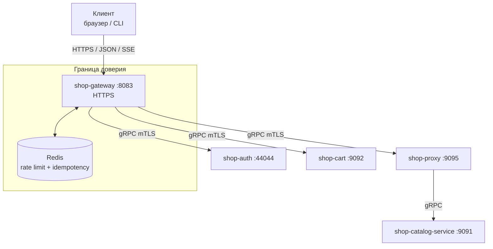
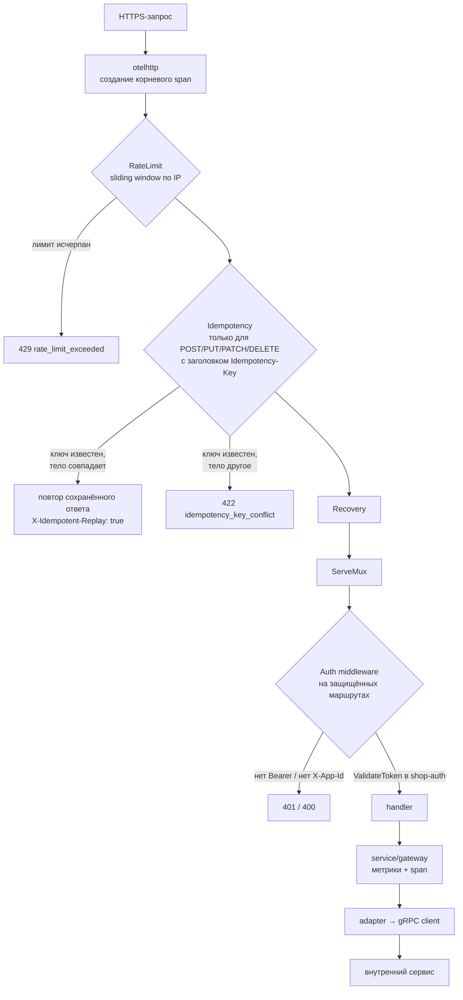
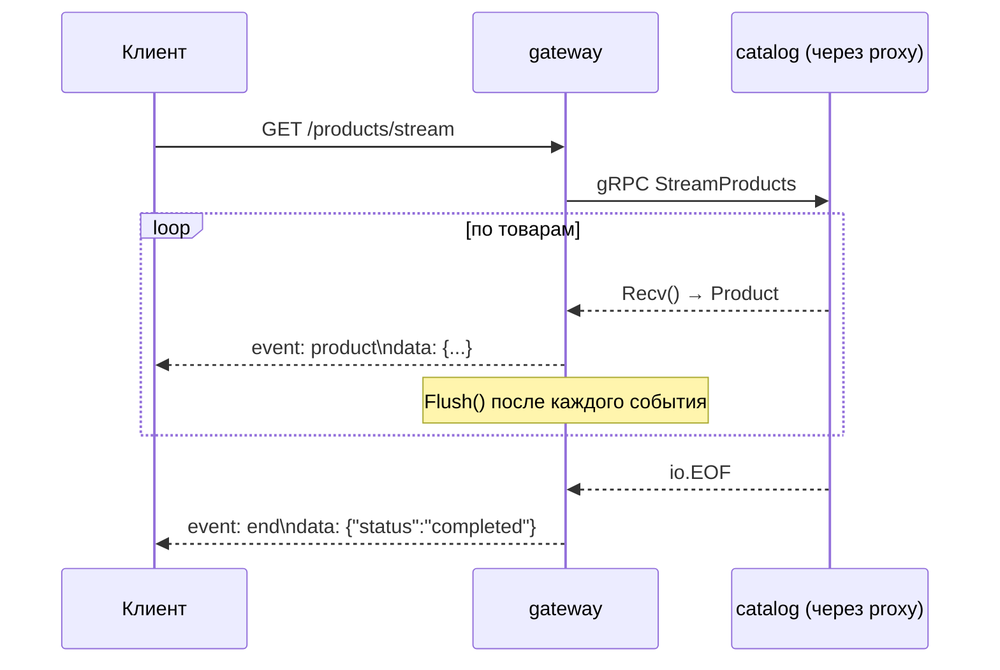

# shop-gateway

Внешняя точка входа системы. Единственный сервис, публикуемый за пределы внутренней сети: принимает HTTPS от клиентов, применяет rate limiting, идемпотентность и JWT-авторизацию, затем разводит запросы по внутренним сервисам через gRPC.

Своих данных не имеет и своей бизнес-логики почти не содержит — это оркестратор и граница доверия.

* **Модуль Go:** `github.com/YagorX/shop-gateway`
* **Точка входа:** [`cmd/gateway`](cmd/gateway)
* **HTTP(S):** `:8083`
* **Зависимости:** `shop-auth`, `shop-cart`, `shop-catalog-service` (через `shop-proxy`), Redis

---

## Роль в системе



Снаружи доступен только `:8083`. Внутренние сервисы не имеют публичных маршрутов и требуют клиентский сертификат — gateway единственный держатель `gateway-client.crt`.

Обращение к каталогу идёт **через `shop-proxy`**, а не напрямую: прокси считает трафик и умеет вносить искусственные задержки для проверки поведения системы под сбоями. Поэтому в конфиге `catalog_grpc.addr: proxy-service:9095`, а `catalog_tls.server_name: proxy-service` — TLS-сессия терминируется на прокси.

---

## Структура

```text
shop-gateway/
├── cmd/
│   ├── gateway/          # основной сервис
│   └── client/grpc/      # smoke-клиент для ручной проверки
├── config/
│   ├── config.local.yaml # HTTP без TLS, gRPC без TLS
│   └── config.docker.yaml# HTTPS + mTLS ко всем трём сервисам
├── openapi/              # source of truth для Swagger UI
├── web/                  # swagger / redoc / status — статика и шаблон
└── internal/
    ├── app/              # bootstrap, retry, lifecycle → app/README.md
    ├── service/gateway/  # оркестрация → service/gateway/README.md
    ├── adapters/         # реализация портов → adapters/README.md
    ├── client/grpc/      # gRPC-клиенты → client/grpc/README.md
    ├── transport/
    │   ├── http/v1/      # роутер и хендлеры → transport/http/v1/README.md
    │   │   └── middleware/  # → middleware/README.md
    │   └── grpc/v1/handlers/ # readiness-чекеры → handlers/README.md
    ├── ratelimit/        # sliding window → ratelimit/README.md
    ├── domain/           # Product, Cart — модели границы
    ├── config/           # cleanenv
    └── observability/    # → observability/README.md
```

Направление зависимостей: `transport → service → ports ← adapters → client`. Сервисный слой объявляет интерфейсы (`ProductRepository`, `AuthRepository`, `CartRepository` в [`service/gateway/ports.go`](internal/service/gateway/ports.go)), адаптеры их реализуют. Замена транспорта до внутреннего сервиса не затрагивает логику.

---

## HTTP API

Полная спецификация — [`openapi/gateway.v1.yaml`](openapi/gateway.v1.yaml), живой Swagger UI на `/swagger/`.

### Товары

| Метод | Путь | Авторизация | Описание |
|---|---|:---:|---|
| `GET` | `/products?limit=&offset=` | ✅ | Список с пагинацией (лимит по умолчанию 20, максимум 100) |
| `GET` | `/products/{id}` | ✅ | Один товар |
| `GET` | `/products/stream?limit=&offset=` | ✅ | SSE-поток товаров |

### Корзина

| Метод | Путь | Авторизация | Описание |
|---|---|:---:|---|
| `GET` | `/cart` | ✅ | Содержимое корзины текущего пользователя |
| `POST` | `/cart/items` | ✅ | Добавить товар |
| `POST` | `/cart/items/update` | ✅ | Изменить количество |
| `DELETE` | `/cart/items/remove` | ✅ | Удалить позицию |
| `POST` | `/cart/clear` | ✅ | Очистить |

`user_id` берётся из проверенного токена, а не из тела запроса — подменить чужую корзину нельзя. Цена позиции (`price_snapshot`) тоже определяется сервером: хендлер сам запрашивает товар в каталоге и берёт актуальную цену, игнорируя всё, что мог прислать клиент.

### Аутентификация

| Метод | Путь | Авторизация | Описание |
|---|---|:---:|---|
| `POST` | `/auth/register` | — | Регистрация |
| `POST` | `/auth/login` | — | Выпуск пары токенов |
| `POST` | `/auth/validate` | — | Проверка access-токена |
| `POST` | `/auth/refresh` | — | Ротация refresh-токена |
| `POST` | `/auth/logout` | — | Отзыв refresh-сессии |
| `POST` | `/auth/is-admin` | ✅ | Проверка роли |

### Эксплуатация

| Метод | Путь | Описание |
|---|---|---|
| `GET` | `/health` | Liveness |
| `GET` | `/ready` | Readiness: health-check всех трёх gRPC-зависимостей |
| `GET` | `/metrics` | Prometheus |
| `GET` | `/status` | HTML-страница состояния (`html/template`) |
| `GET` `POST` | `/admin/log-level` | Уровень логирования |
| `GET` | `/swagger/`, `/redoc/` | Документация API |

### Формат ошибок

Единый для всех эндпоинтов:

```json
{ "error": { "code": "unauthorized", "message": "token validation failed" } }
```

Стабильные значения `error.code`: `bad_request`, `method_not_allowed`, `invalid_pagination`, `invalid_product_id`, `product_not_found`, `already_exists`, `not_found`, `unauthorized`, `unauthenticated`, `rate_limit_exceeded`, `idempotency_key_conflict`, `idempotency_unavailable`, `internal_error`.

---

## Обработка запроса



Порядок неслучаен. Rate limiting стоит **до** авторизации, иначе перебор токенов был бы бесплатным для атакующего. Идемпотентность — до хендлера, чтобы повтор не доходил до внутренних сервисов. `Recovery` — последним в цепочке обёрток, то есть ближайшим к хендлеру.

### Авторизация

Middleware требует два заголовка:

```
Authorization: Bearer <access_token>
X-App-Id: 1
```

Токен проверяется вызовом `ValidateToken` в `shop-auth` — gateway не разбирает JWT сам и не знает секретов подписи. Успешная проверка кладёт `user_uuid` и `app_id` в контекст запроса, откуда их берут хендлеры.

Цена решения — сетевой вызов на каждый защищённый запрос. Выгода — мгновенная реакция на деактивацию пользователя и отсутствие ключей подписи за пределами `shop-auth`.

### SSE-поток



Внутренний server-streaming gRPC превращается во внешний `text/event-stream`. Клиенту не нужен gRPC-стек, а соединение остаётся одно.

---

## Конфигурация

| Группа | Ключи | Назначение |
|---|---|---|
| `http` | `port`, `timeout` | Порт 8083 |
| `http_tls` | `enabled`, `cert_file`, `key_file` | Внешний HTTPS |
| `catalog_grpc` | `addr`, `timeout` | В docker — `proxy-service:9095` |
| `catalog_tls` | `enabled`, `ca_file`, `server_name`, `client_cert_file`, `client_key_file` | mTLS до прокси |
| `auth_grpc` / `auth_tls` | то же | mTLS до `auth-service` |
| `cart_grpc` / `cart_tls` | то же | mTLS до `cart-service` |
| `redis` | `addr`, `password`, `db`, `timeout` | Rate limit и идемпотентность |
| `rate_limit` | `limit` (100), `window` (1m) | Лимит на IP |
| `retry` | `max_retries` (6), `initial_interval` (2s), `max_interval` (32s) | Подключение к gRPC при старте |
| `swagger` | `ui_path`, `redoc_path`, `spec_path` | Пути к статике |
| `template_path` | | HTML-шаблон `/status` |
| `otlp` | `endpoint` | Экспорт трейсов |

Локальный конфиг отличается принципиально: `http_tls.enabled: false` и TLS ко всем сервисам выключен — для `go run` на хосте без сертификатов.

---

## Запуск

### Локально

Нужны поднятые `auth-service`, `catalog-service`, `cart-service` и Redis: gateway при старте **блокирующе** дозванивается до всех трёх и без них не стартует.

```bash
go run ./cmd/gateway --config config/config.local.yaml

curl http://127.0.0.1:8083/health
curl http://127.0.0.1:8083/ready
curl "http://127.0.0.1:8083/products?limit=5"
```

### В составе платформы

```bash
cd ../shop-platform/deploy
docker compose up -d --build gateway-service
```

Наружу — HTTPS с самоподписанным сертификатом, поэтому `curl` нужен флаг `-k`:

```bash
curl -k https://localhost:8083/ready
curl -k https://localhost:8083/status

# регистрация и вход
curl -k -X POST https://localhost:8083/auth/register \
  -H "Content-Type: application/json" \
  -d '{"username":"demo","email":"demo@example.com","password":"Test123!"}'

TOKEN=$(curl -sk -X POST https://localhost:8083/auth/login \
  -H "Content-Type: application/json" \
  -d '{"email_or_name":"demo","password":"Test123!","app_id":1,"device_id":"dev-1"}' \
  | jq -r .access_token)

curl -k -H "Authorization: Bearer $TOKEN" -H "X-App-Id: 1" https://localhost:8083/products
curl -Nk -H "Authorization: Bearer $TOKEN" -H "X-App-Id: 1" https://localhost:8083/products/stream
```

Проверка идемпотентности — два одинаковых запроса с одним ключом дают один результат:

```bash
curl -k -X POST https://localhost:8083/cart/items \
  -H "Authorization: Bearer $TOKEN" -H "X-App-Id: 1" \
  -H "Idempotency-Key: demo-key-1" \
  -d '{"product_id":"prod-001","quantity":1}' -i | grep -i x-idempotent-replay
```

Проверка rate limiting — 101-й запрос за минуту получает 429:

```bash
for i in $(seq 1 105); do
  curl -k -s -o /dev/null -w "%{http_code}\n" https://localhost:8083/health
done | sort | uniq -c
```

---

## Observability

| Метрика | Метки |
|---|---|
| `gateway_service_requests_total` | `method`, `status` |
| `gateway_service_request_duration_seconds` | `method` |
| `gateway_http_requests_total` | `method`, `path`, `status` |
| `gateway_http_request_duration_seconds` | `method`, `path` |
| `gateway_grpc_requests_total` | `method`, `code` |
| `gateway_grpc_request_duration_seconds` | `method` |

Prometheus скрейпит gateway **по HTTPS** с `insecure_skip_verify` — единственный такой таргет в стенде.

Трейсы: входящий HTTP инструментирован `otelhttp`, сервисный слой создаёт спаны `service.gateway.*`, исходящие клиенты — `otelgrpc.NewClientHandler()`. В Jaeger видны сквозные цепочки `gateway → auth`, `gateway → proxy → catalog`, `gateway → cart`.

---

## Тесты

```bash
go test ./internal/...
```

* [`internal/transport/http/v1/router_test.go`](internal/transport/http/v1/router_test.go) — маршрутизация и коды ответов
* [`internal/transport/http/v1/handlers/cart_test.go`](internal/transport/http/v1/handlers/cart_test.go) — хендлеры корзины на подменённых сервисах (483 строки, самый полный тест в проекте)

---

## Известные проблемы

1. **Rate limiter считает по `r.RemoteAddr`.** За балансировщиком или CDN это будет один и тот же адрес для всех клиентов — общий лимит на всех. `X-Forwarded-For` не разбирается.
2. **Деньги проходят через float.** Каталог отдаёт цену как `double` (`price = price_cents / 100.0`), адаптер конвертирует обратно: `int64(math.Round(p.GetPrice() * 100))` в [`internal/adapters/catalog_grpc/repository.go`](internal/adapters/catalog_grpc/repository.go). Округление спасает на обычных значениях, но тип в контракте противоречит целочисленному `price_cents`, которым пользуются все остальные сервисы и Kafka-события. Правильно — `int64` копеек в самом proto.
3. **Readiness открывает новое соединение на каждый вызов.** Каждый из трёх чекеров в [`internal/transport/grpc/v1/handlers`](internal/transport/grpc/v1/handlers) делает `grpc.DialContext(..., WithBlock())` и закрывает соединение. При healthcheck раз в 10 секунд это три TCP+TLS-рукопожатия каждые 10 секунд, а `/ready` может отвалиться из-за установки соединения при полностью живом рабочем клиенте. Нужно вызывать `Health/Check` на уже существующих `conn` из `App`.
4. **Retry игнорирует отмену контекста.** [`internal/app/retry.go`](internal/app/retry.go) ждёт через `time.Sleep`, поэтому `ctx.Done()` проверяется только между попытками. При `max_retries: 6` и `max_interval: 32s` старт может держаться около минуты, не реагируя на SIGTERM.
5. **`WithBlock()` превращает недоступность зависимости в отказ старта.** Отсюда наблюдаемый crash-loop контейнера, когда `catalog-service` ещё не поднялся. Ленивое `grpc.NewClient` дало бы работающий процесс, честно отвечающий `/ready → 503`. Заодно `grpc.DialContext` и `WithBlock` помечены deprecated.
6. **Сервисный слой на 958 строк.** [`internal/service/gateway/gateway.go`](internal/service/gateway/gateway.go) — 15 методов, каждый повторяет один и тот же блок из ~50 строк: метрики, span, `ensureInitialized`, маппинг ошибок. Первый кандидат на вынос в декоратор.
7. **Утечка соединения в ветке ошибки.** В [`internal/app/app.go`](internal/app/app.go) обработка ошибки `cart_adapter` закрывает catalog- и auth-клиентов, но не `grpc_cart_client`.
8. **Неверная метка пути в метриках корзины.** `RemoveItem`, `UpdateItem` и `ClearCart` в [`handlers/cart.go`](internal/transport/http/v1/handlers/cart.go) пишут в метку `path` значение `/cart/items`, хотя обслуживают `/cart/items/remove`, `/cart/items/update` и `/cart/clear`.
9. **`/admin/log-level` и `/status` без авторизации** при том, что порт публичный.
10. **RPC-стиль в REST API.** `/cart/items/update`, `/cart/items/remove`, `/cart/clear` выбиваются из остальной схемы — ожидались бы `PATCH /cart/items/{product_id}`, `DELETE /cart/items/{product_id}`, `DELETE /cart`.
11. **`slog.Error` вместо `service.logger`** в отдельных ветках `gateway.go` — пишет в глобальный логгер, минуя сконфигурированный.
12. **Незакоммиченные изменения** на момент аудита: 8 файлов, включая +934/−232 строки в `openapi/gateway.v1.yaml`.
