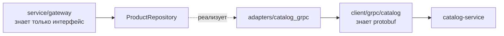

# internal/adapters

Реализация портов сервисного слоя. Каждый адаптер — тонкая прослойка между интерфейсом из [`service/gateway/ports.go`](../service/gateway/ports.go) и gRPC-клиентом из [`client/grpc`](../client/grpc).

```text
adapters/
├── catalog_grpc/   # ProductRepository
├── auth_grpc/      # AuthRepository
└── cart_grpc/      # CartRepository
```

## Зачем отдельный слой



Разделение даёт две вещи:

1. **Сервисный слой не зависит от protobuf.** В `service/gateway` нет импортов `catalogv1` — он работает с `domain.Product`. Смена контракта или транспорта не трогает логику.
2. **Маппинг сосредоточен в одном месте.** Перевод protobuf-структур в доменные и gRPC-кодов в доменные ошибки происходит здесь, а не растекается по хендлерам.

## Маппинг ошибок

Адаптеры разбирают `status.FromError` и переводят коды в доменные значения:

| gRPC code | Доменная ошибка |
|---|---|
| `NotFound` | `domain.ErrProductNotFound` |
| `InvalidArgument` | `domain.ErrInvalidPagination` и подобные |
| `AlreadyExists` | ошибка «уже существует» |
| `Unauthenticated` | ошибка авторизации |
| прочее | обёрнутая исходная ошибка |

Выше этого слоя gRPC-коды не встречаются: сервис и хендлеры сравнивают через `errors.Is` с доменными значениями.

## Маппинг данных

`catalog_grpc` конвертирует `catalogv1.Product` в `domain.Product`. Здесь же происходит преобразование цены:

```go
PriceCents: int64(math.Round(p.GetPrice() * 100)),
```

Каталог хранит цену в копейках (`price_cents int64`), но proto объявляет её как `double price`, поэтому на границе она делится на 100, а здесь умножается обратно. См. «Известные проблемы».

## Известные проблемы

* **Деньги проходят через `float64`.** Полная цепочка: `price_cents int64` в БД каталога → `float64(p.PriceCents)/100.0` в его gRPC-хендлере → `double price` в контракте → `int64(math.Round(price*100))` здесь. `math.Round` спасает на обычных суммах, но тип в контракте противоречит целочисленному представлению, которым пользуются и БД каталога, и Kafka-событие `catalog.products.v1` (там `price_cents`), и корзина (`price_snapshot int64`). Правильное решение — заменить в [`catalog.proto`](../../../shop-contracts/proto/catalog/v1/catalog.proto) `double price` на `int64 price_cents` и убрать обе конвертации.
* **`Stock` конвертируется между `uint32` и `int32`.** Proto объявляет `uint32 stock`, домен и события используют `int32`. Приведение без проверки: значение больше `MaxInt32` даст отрицательный остаток.
* **Конструкторы возвращают ошибку, которая невозможна.** `NewRepository(client)` проверяет `client != nil` и возвращает `(*Repository, error)` — из-за этого в [`internal/app`](../app) появляются три ветки обработки ошибок, которые не могут сработать.
