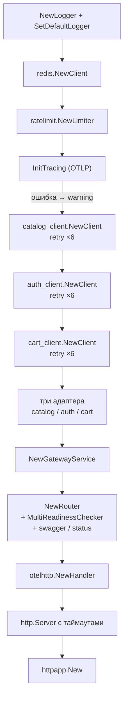

# internal/app

Сборка сервиса и управление его временем жизни. Здесь встречаются конкретные реализации; все остальные пакеты работают с интерфейсами.

```text
app/
├── app.go     # граф зависимостей, Run, Errors, Shutdown
├── retry.go   # exponential backoff для подключения к gRPC
└── httpapp/   # обёртка над http.Server (HTTP или HTTPS)
```

## Порядок сборки



Каждая ветка ошибки закрывает уже созданные клиенты и останавливает трейсинг — иначе неудачный старт оставил бы открытые соединения и неотправленные спаны.

## Таймауты HTTP-сервера

Задаются явно, а не остаются нулевыми:

| Параметр | Значение | Зачем |
|---|---|---|
| `ReadHeaderTimeout` | 5s | Защита от Slowloris: соединение, не присылающее заголовки, отваливается |
| `ReadTimeout` | 10s | Ограничение на чтение тела |
| `WriteTimeout` | 15s | Ограничение на запись ответа |
| `IdleTimeout` | 60s | Закрытие keep-alive соединений без активности |

`WriteTimeout` в 15 секунд важно держать в голове при работе с `/products/stream`: SSE-поток дольше этого срока будет обрублен сервером.

## Retry при подключении

[`retry.go`](retry.go) — `retryWithExponentialBackoff(ctx, operation, maxRetries, initial, max)`.

| Попытка | Пауза перед следующей |
|---|---|
| 0 | 2s |
| 1 | 4s |
| 2 | 8s |
| 3 | 16s |
| 4 | 32s (упор в `max_interval`) |
| 5 | последняя, без паузы |

Задержка считается как `initialInterval * (1 << attempt)` с ограничением сверху. Нужен потому, что gRPC-клиенты создаются с `WithBlock()` — соединение устанавливается сразу, а зависимый сервис в compose может ещё подниматься.

## Lifecycle

`Run()` запускает HTTP-сервер в горутине и сразу возвращается. Ошибки времени выполнения идут в буферизованный канал `Errors()`, который слушает `main` параллельно с сигналами ОС.

`Shutdown(ctx)` останавливает HTTP-сервер, флашит трейсы и закрывает три gRPC-клиента, собирая ошибки через `errors.Join` — одна неудача не прерывает остальные шаги.

## Известные проблемы

* **Retry не реагирует на отмену.** Пауза сделана через `time.Sleep`, поэтому `ctx.Done()` проверяется только между попытками. Полный цикл занимает до ~62 секунд, в течение которых SIGTERM игнорируется. Нужен `select` с `time.After(interval)` и `ctx.Done()`.
* **`WithBlock()` делает старт хрупким.** Недоступность любого из трёх сервисов — отказ запуска и crash-loop контейнера. Ленивое подключение (`grpc.NewClient`) позволило бы процессу подняться и честно отвечать `/ready → 503`, что мягче для оркестратора.
* **Утечка в ветке ошибки:** обработка неудачи `cart_adapter` закрывает catalog- и auth-клиентов, но забывает `grpc_cart_client`.
* **Повторяющиеся блоки очистки.** Пять почти одинаковых ветвей `stopTracing(); _ = X.Close(); ...`. Стек `io.Closer` или `defer` с флагом успеха убрал бы дублирование и заодно баг выше.
* **Redis не проверяется при старте.** `redis.NewClient` не подключается, а `Ping` не вызывается — недоступность Redis обнаружится только на первом запросе, причём как `500`.
* **Неиспользуемый импорт-заглушка:** `_ "github.com/YagorX/shop-gateway/internal/transport/grpc/v1/handlers"` рядом с обычным импортом того же пакета.
