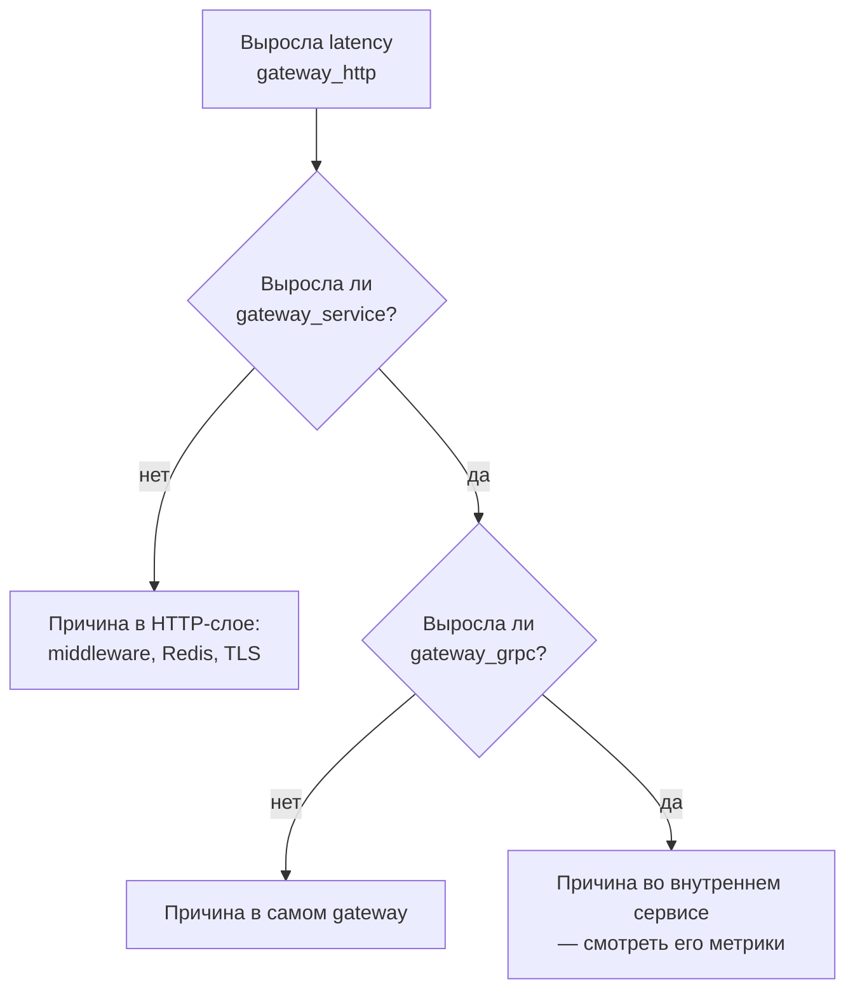

# internal/observability

Логи, метрики и трейсы gateway. Структура и принципы совпадают с одноимёнными пакетами в остальных сервисах — различаются только имена метрик и набор инструментируемых слоёв.

```text
observability/
├── logger.go    # slog JSON + LevelVar для смены уровня на живом процессе
├── metrics.go   # Prometheus-коллекторы, MustMetrics()
└── tracing.go   # OTLP-экспортёр, otelhttp / otelgrpc
```

## Три уровня метрик

У gateway их ровно три, и это соответствует трём слоям, через которые проходит запрос:

| Уровень | Метрика | Метки | Что измеряет |
|---|---|---|---|
| HTTP | `gateway_http_requests_total` | `method`, `path`, `status` | Внешняя граница: что видит клиент |
| HTTP | `gateway_http_request_duration_seconds` | `method`, `path` | |
| Сервис | `gateway_service_requests_total` | `method`, `status` | Оркестрация: бизнес-операция целиком |
| Сервис | `gateway_service_request_duration_seconds` | `method` | |
| gRPC | `gateway_grpc_requests_total` | `method`, `code` | Исходящие вызовы к внутренним сервисам |
| gRPC | `gateway_grpc_request_duration_seconds` | `method` | |

Разделение позволяет локализовать проблему по форме графиков:



Без этого разделения рост времени ответа выглядел бы одинаково независимо от причины.

Метка `code` в gRPC-метриках берётся из `status.Code(err).String()`, то есть в Prometheus видно распределение по конкретным кодам — `NotFound` от `Unavailable` отличимы.

## MustMetrics

Синглтон через `sync.Once`. `prometheus.MustRegister` паникует при повторной регистрации коллектора с тем же именем, а метрики нужны в пакетах, которые создаются не единожды (хендлеры, клиенты, сервис). Вызов `MustMetrics()` в любом месте возвращает тот же экземпляр.

## Трейсинг

| Слой | Инструмент | Что даёт |
|---|---|---|
| Входящий HTTP | `otelhttp.NewHandler(router, "gateway.http")` | Корневой span, извлечение `traceparent` из заголовков |
| Сервис | `otel.Tracer(...).Start(ctx, op)` вручную | Спаны `service.gateway.*` |
| Исходящий gRPC | `otelgrpc.NewClientHandler()` | Клиентские спаны, вставка `traceparent` в метаданные |

Ручные спаны в сервисном слое нужны потому, что одна HTTP-операция может складываться из нескольких gRPC-вызовов — например `AddItem` сначала запрашивает товар в каталоге, потом пишет в корзину. Без промежуточного span два вызова выглядели бы не связанными между собой.

Пропагация — W3C `traceparent` (`propagation.TraceContext`). Тот же формат требуют event-контракты в [`shop-contracts/events`](../../../shop-contracts/events), поэтому трейс продолжается и через асинхронные шаги.

Экспортёр батчевый (`WithBatchTimeout(2s)`), поэтому `shutdownTracing` при остановке обязателен — иначе теряется хвост спанов.

## Деградация

Недоступность OTLP-коллектора не мешает запуску: `internal/app` логирует warning и продолжает с `shutdownTracing = nil`. Логи и метрики локальны и отказать не могут.

## Особенность скрейпинга

gateway — единственный сервис в стенде, который Prometheus скрейпит **по HTTPS**:

```yaml
- job_name: "gateway-service"
  scheme: https
  tls_config: { insecure_skip_verify: true }
  static_configs:
    - targets: ["gateway-service:8083"]
```

`insecure_skip_verify` здесь потому, что сертификат подписан локальным самоподписанным CA, который Prometheus не знает. Корректнее было бы дать Prometheus `ca_file` с тем же CA.

## Известные проблемы

* **`path` в метриках задаётся вручную в каждом хендлере,** и в трёх хендлерах корзины указан неверно: `RemoveItem`, `UpdateItem` и `ClearCart` пишут `path="/cart/items"` вместо своих путей. В Prometheus три эндпоинта сливаются в один.
* **Нет sampler-политики.** `NewTracerProvider` без `WithSampler` — значит `ParentBased(AlwaysSample)` и отправка всех спанов под любой нагрузкой.
* **Нет метрик по middleware.** Отказы rate limiter (`429`) и конфликты идемпотентности (`422`) видны только в общем `gateway_http_requests_total` по статусу; отдельных счётчиков, по которым удобно строить алерты, нет.
* **Нет метрик состояния gRPC-соединений** — недоступность внутреннего сервиса заметна только через рост ошибок, а не напрямую.
