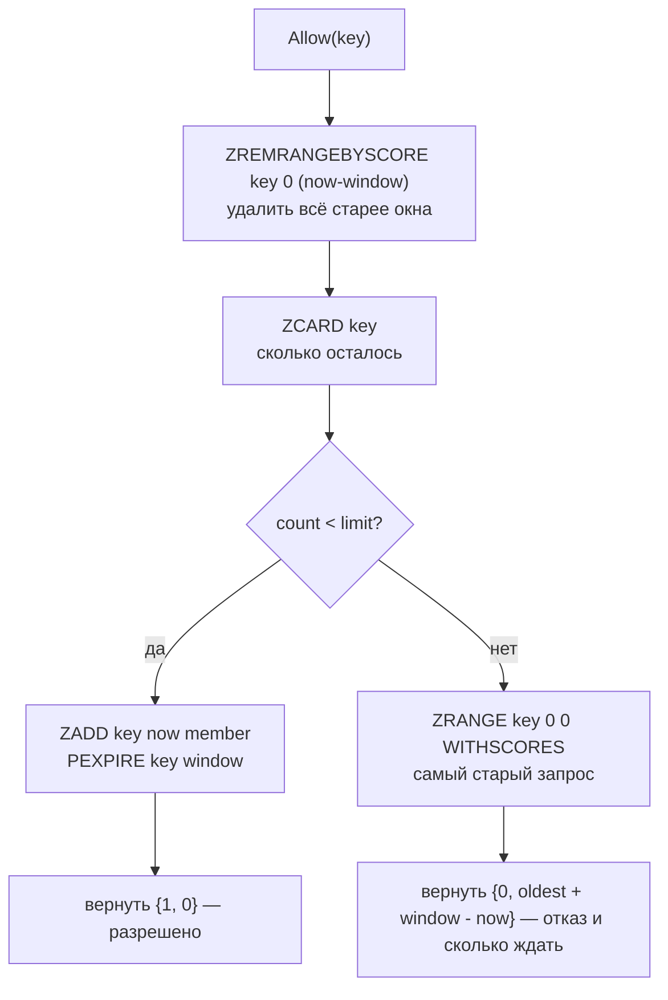

# internal/ratelimit

Распределённое ограничение частоты запросов. Алгоритм — **sliding window** на Redis sorted set, вся проверка выполняется одним Lua-скриптом.

## API

```go
func NewLimiter(client *redis.Client, limit int, window time.Duration) *Limiter
func (l *Limiter) Allow(ctx context.Context, key string) (allowed bool, retryAfter time.Duration, err error)
```

`retryAfter` заполнен только при отказе: через столько освободится место в окне. Middleware кладёт его в `Retry-After`. Ошибка означает недоступность Redis, а не исчерпание лимита.

```go
func NewFailureLimiter(client *redis.Client, limit int, window time.Duration, prefix string) *FailureLimiter
func (l *FailureLimiter) Blocked(ctx context.Context, key string) (retryAfter time.Duration, err error)
func (l *FailureLimiter) Fail(ctx context.Context, key string) (blockedNow bool, err error)
```

`FailureLimiter` считает не все запросы, а только то, что вызывающий объявил неудачей, — сейчас это `401` на `/auth/login` в [`middleware.LoginFailureLimit`](../transport/http/v1/middleware). `blockedNow` выставлен ровно на той неудаче, что достигла порога: по нему блокировка логируется один раз.

Ключ передаёт вызывающий — [`middleware.RateLimit`](../transport/http/v1/middleware) использует IP клиента. Ничто не мешает лимитировать по `user_uuid` или по паре «пользователь + эндпоинт».

## Алгоритм

Каждый запрос — элемент в sorted set: score — время в миллисекундах, член — уникальный id запроса (`<время>-<случайное число>`, генерируется в Go). Окно «скользит» за счёт удаления устаревших элементов перед каждым подсчётом.



```lua
local key    = KEYS[1]
local window = tonumber(ARGV[1])
local limit  = tonumber(ARGV[2])
local now    = tonumber(ARGV[3])
local member = ARGV[4]

redis.call('ZREMRANGEBYSCORE', key, 0, now - window)
local count = tonumber(redis.call('ZCARD', key))

if count < limit then
    redis.call('ZADD', key, now, member)
    redis.call('PEXPIRE', key, window)
    return {1, 0}
end

-- Место освободится, когда самый старый запрос выпадет из окна.
local oldest = tonumber(redis.call('ZRANGE', key, 0, 0, 'WITHSCORES')[2])
return {0, oldest + window - now}
```

## Почему Lua

Четыре команды должны выполниться атомарно. Если разнести их на отдельные вызовы, между `ZCARD` и `ZADD` вклинятся конкурирующие запросы, и при лимите 100 реально пройдёт больше. Redis выполняет скрипт как одну операцию, гонки не возникает.

`redis.NewScript` использует `EVALSHA`: скрипт грузится в Redis один раз, дальше передаётся только его хэш.

`PEXPIRE` на каждом успешном запросе — защита от утечки памяти: ключи неактивных клиентов исчезают сами через время окна.

Член множества уникален не просто так: элементы sorted set не повторяются, и при члене, равном времени, два запроса в одну миллисекунду слились бы в одну запись — лимит протекал бы ровно под нагрузкой.

## FailureLimiter: фиксированное окно

Ключ `<prefix>:<key>` (в gateway — `ratelimit:login-failures:<ip>`), значение — число неудач, TTL — окно от первой неудачи.

| Метод | Команды | Почему так |
|---|---|---|
| `Fail` | `MULTI` → `INCR` + `EXPIRE … NX` → `EXEC` | `MULTI` — чтобы при обрыве соединения не остался ключ без TTL, то есть вечная блокировка. `NX` (Redis 7) — срок ставит только первая неудача: без него каждая неудача продлевала бы окно, и у офиса с редкими опечатками счётчик не обнулялся бы никогда |
| `Blocked` | конвейер `GET` + `PTTL` | Два чтения; рассинхрон между ними стоит одной неудачи. `redis.Nil` от `GET` — «неудач не было», а не ошибка |

Скользящее окно здесь не нужно: на стыке окон можно успеть до 2×`limit` неудач, зато счётчик — одно число вместо записи на каждую попытку.

## Sliding window против альтернатив

| Подход | Точность | Стоимость | Когда подходит |
|---|---|---|---|
| **Sliding window (здесь)** | Точная: учитывает реальные моменты запросов | Один RTT, память O(limit) на ключ | Несколько инстансов за балансировщиком |
| Fixed window (`INCR` + `EXPIRE`) | Пропускает всплески на стыке окон — до 2×limit | Один RTT, память O(1) | Когда важнее память, чем точность |
| Token bucket | Сглаживает, допускает контролируемые всплески | Один RTT, память O(1) | Высоконагруженные API |
| In-memory (`x/time/rate`) | Точная, но только в пределах процесса | Нулевая | Один инстанс или sidecar |

Sliding window выбран потому, что лимит должен быть общим для всех реплик gateway — состояние обязано жить вне процесса.

Плата — память: каждый элемент окна хранится отдельно, то есть при лимите 100 в set до 100 записей на клиента.

## Известные проблемы

* **Нет `X-RateLimit-Limit` и `X-RateLimit-Remaining`.** При `429` клиент получает `Retry-After`, но лимит и остаток до отказа не сообщаются; остаток (`limit - count`) скрипт мог бы вернуть третьим числом.
* **Один общий лимит на все эндпоинты.** `/health`, каталог и вход расходуют общий бюджет, а за одним NAT-адресом его делит целый офис. Подбор паролей закрыт отдельно — лимитом неудач по IP (`FailureLimiter`) и лимитом по логину в auth; общий лимит для защищённых маршрутов правильнее считать по `user_uuid`.
* **Пока Redis лежит, лимита по IP нет.** Middleware при ошибке пропускает запрос (fail-open): падение Redis не кладёт публичный API, но и не ограничивает его. Логин при этом всё равно защищён семафором на bcrypt и лимитом по логину в auth. Пропуск при этом не мгновенный: клиент Redis создан без таймаутов и повторяет подключение, это около 2 секунд на запрос (см. «Известные проблемы» в README сервиса).
* **Время берётся из Go, а не из Redis.** Расхождение часов между инстансами gateway сдвигает окно: запросы с «отстающего» инстанса выпадают из окна раньше. В пределах NTP это миллисекунды; `redis.call('TIME')` убрал бы зависимость от часов приложения.
