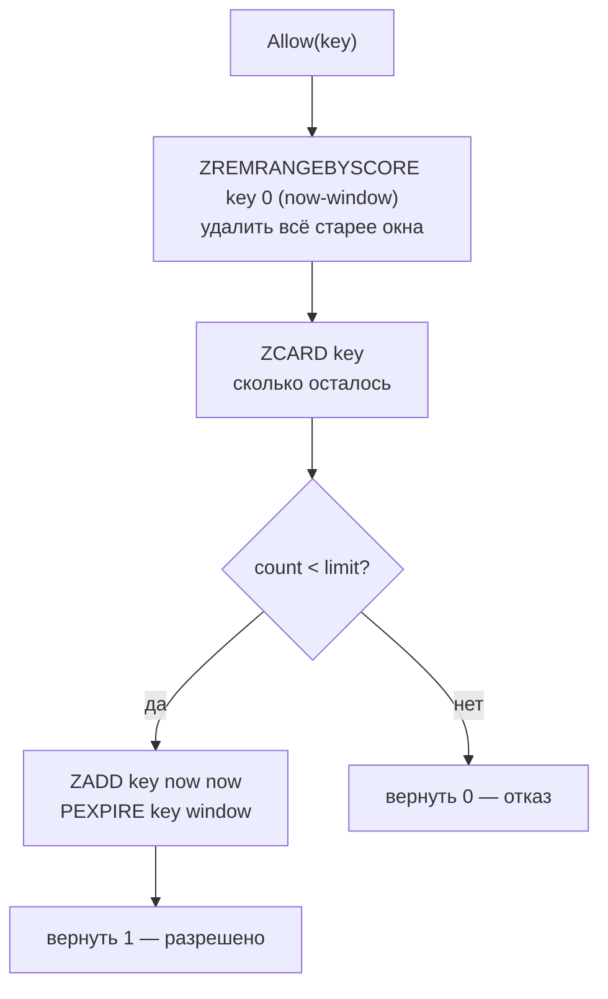

# internal/ratelimit

Распределённое ограничение частоты запросов. Алгоритм — **sliding window** на Redis sorted set, вся проверка выполняется одним Lua-скриптом.

## API

```go
func NewLimiter(client *redis.Client, limit int, window time.Duration) *Limiter
func (l *Limiter) Allow(ctx context.Context, key string) (bool, error)
```

Ключ передаёт вызывающий — [`middleware.RateLimit`](../transport/http/v1/middleware) использует IP клиента. Ничто не мешает лимитировать по `user_uuid` или по паре «пользователь + эндпоинт».

## Алгоритм

Каждый запрос — элемент в sorted set с score, равным времени в миллисекундах. Окно «скользит» за счёт удаления устаревших элементов перед каждым подсчётом.



```lua
local key    = KEYS[1]
local window = tonumber(ARGV[1])
local limit  = tonumber(ARGV[2])
local now    = tonumber(ARGV[3])

redis.call('ZREMRANGEBYSCORE', key, 0, now - window)
local count = tonumber(redis.call('ZCARD', key))

if count < limit then
    redis.call('ZADD', key, now, now)
    redis.call('PEXPIRE', key, window)
    return 1
end
return 0
```

## Почему Lua

Четыре команды должны выполниться атомарно. Если разнести их на отдельные вызовы, между `ZCARD` и `ZADD` вклинятся конкурирующие запросы, и при лимите 100 реально пройдёт больше. Redis выполняет скрипт как одну операцию, гонки не возникает.

`redis.NewScript` использует `EVALSHA`: скрипт грузится в Redis один раз, дальше передаётся только его хэш.

`PEXPIRE` на каждом успешном запросе — защита от утечки памяти: ключи неактивных клиентов исчезают сами через время окна.

## Sliding window против альтернатив

| Подход | Точность | Стоимость | Когда подходит |
|---|---|---|---|
| **Sliding window (здесь)** | Точная: учитывает реальные моменты запросов | Один RTT, память O(limit) на ключ | Несколько инстансов за балансировщиком |
| Fixed window (`INCR` + `EXPIRE`) | Пропускает всплески на стыке окон — до 2×limit | Один RTT, память O(1) | Когда важнее память, чем точность |
| Token bucket | Сглаживает, допускает контролируемые всплески | Один RTT, память O(1) | Высоконагруженные API |
| In-memory (`x/time/rate`) | Точная, но только в пределах процесса | Нулевая | Один инстанс или sidecar |

Sliding window выбран потому, что лимит должен быть общим для всех реплик gateway — состояние обязано жить вне процесса.

Плата — память: каждый элемент окна хранится отдельно, то есть при лимите 100 в set до 100 записей на клиента.

## Известные проблемы

* **Коллизия членов sorted set — запросы теряются.** `ZADD key now now` использует timestamp и как score, и как **член**. `ZADD` с уже существующим членом только обновляет score, не увеличивая размер set. Значит два запроса, попавшие в одну миллисекунду, учтутся как один, и `ZCARD` будет меньше реального числа — лимит протекает ровно там, где он нужнее всего, под нагрузкой. Починка: делать член уникальным, например `now .. ":" .. uuid` (передавать из Go) или через `redis.call('INCR', key..':seq')`.
* **`Allow` не различает причины отказа.** Возвращается `(false, err)` при ошибке Redis и `(false, nil)` при исчерпании лимита, из-за чего middleware не может отличить перегрузку от недоступности инфраструктуры без проверки `err != nil`. Работает, но осмысленнее было бы вернуть остаток лимита и время сброса.
* **Нет заголовков ответа.** Клиенту не сообщается ни лимит, ни остаток, ни момент сброса. Стандартная практика — `X-RateLimit-Limit`, `X-RateLimit-Remaining`, `Retry-After` при `429`; данные для этого уже есть внутри скрипта.
* **Один лимит на все эндпоинты.** `/health` и `/auth/login` расходуют общий бюджет. Для `/auth/login` осмысленнее отдельный, более жёсткий лимит по логину, а не по IP — это защита от подбора пароля.
* **Redis — единая точка отказа.** Middleware при ошибке возвращает `500`, то есть падение Redis обрушивает публичный API целиком.
