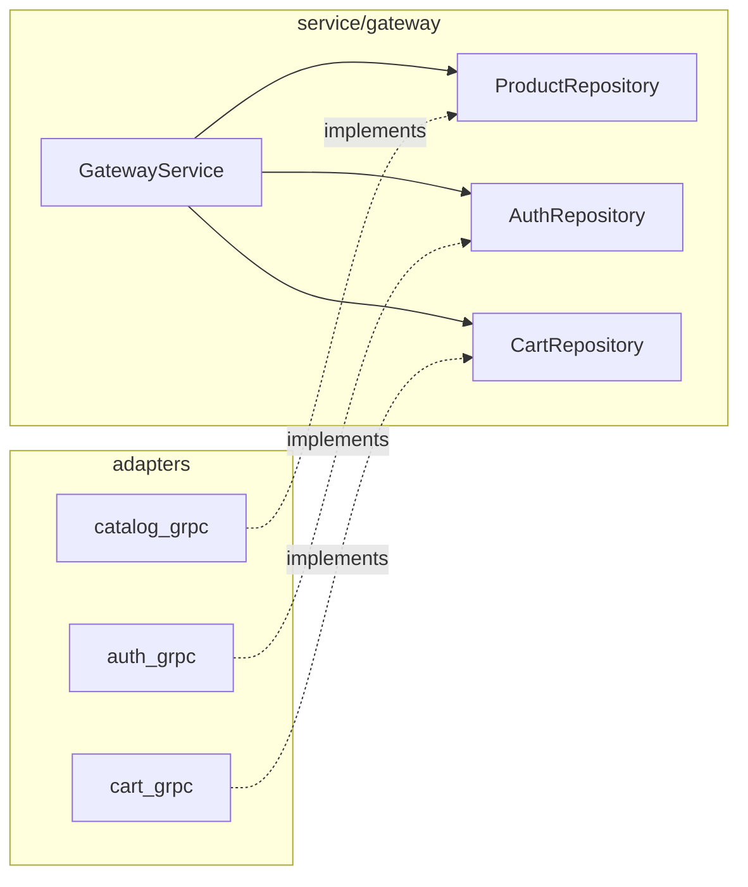

# internal/service/gateway

Сервисный слой gateway. Оркестрирует вызовы внутренних сервисов, нормализует входные данные, переводит ошибки транспорта в доменные и инструментирует каждую операцию.

Бизнес-правил у gateway почти нет — они живут в `shop-auth`, `shop-catalog-service` и `shop-cart`. Здесь остаётся то, что относится к границе системы: пагинация, проверка обязательных полей, единый формат ошибок.

## Порты

[`ports.go`](ports.go) объявляет, что слою нужно от внешнего мира. Реализации — в [`internal/adapters`](../../adapters).



Интерфейсы объявлены на стороне потребителя, а не рядом с реализацией — так сервис диктует форму зависимости, а не наоборот.

## Методы

| Группа | Методы |
|---|---|
| Каталог | `ListProducts`, `GetProduct`, `StreamProducts` |
| Auth | `Register`, `Login`, `ValidateToken`, `Refresh`, `Logout`, `IsAdmin` |
| Корзина | `AddItem`, `GetCart`, `RemoveItem`, `UpdateItem`, `ClearCart` |

`GatewayService` реализует сразу три контракта транспортного слоя (`ProductService`, `AuthService`, `CartService`), поэтому в роутер передаётся один и тот же объект трижды.

## Единая структура метода

Каждый метод построен по одной схеме:

```go
const op = "service.gateway.ListProducts"
startedAt := time.Now()
metrics := observability.MustMetrics()
ctx, span := otel.Tracer("shop-gateway/internal/service/gateway").Start(ctx, op)
defer span.End()
defer func() {
    metrics.GatewayServiceRequestDuration.WithLabelValues("ListProducts").Observe(time.Since(startedAt).Seconds())
}()

if err := service.ensureInitialized(); err != nil { /* метрика + span.RecordError */ }
// нормализация входа
// вызов репозитория
// маппинг ошибки или успех
```

Ошибки попадают и в span (`RecordError` + `SetStatus(codes.Error)`), и в счётчик с меткой статуса (`ok`, `error`, `invalid_argument`, `not_found`). Это даёт возможность в Jaeger найти конкретный проблемный запрос, а в Prometheus увидеть долю таких запросов.

## Нормализация пагинации

```go
const (
    defaultListLimit = 20
    maxListLimit     = 100
)
```

`normalizePagination(limit, offset)`: нулевой лимит заменяется на 20, превышение 100 — отклоняется, отрицательные значения — ошибка `ErrInvalidPagination`. Ограничение сверху защищает каталог от запроса всей таблицы одним вызовом.

## Стриминг

`StreamProducts` возвращает интерфейс `ProductStream`, а не слайс — gateway не материализует поток в памяти. Хендлер читает элементы по одному и сразу отдаёт их клиенту как SSE-события, поэтому объём ответа не ограничен размером памяти процесса.

## Известные проблемы

* **958 строк и ~50 строк дублирования на метод.** Преамбула с метриками, span и `ensureInitialized` повторяется 15 раз. Выносится в декоратор или хелпер вида:

  ```go
  func observed[T any](ctx context.Context, op, method string, fn func(context.Context) (T, error)) (T, error)
  ```

  Это убрало бы около половины файла и заодно исключило рассинхрон, когда в одном методе забыли метку или `span.RecordError`.
* **`ensureInitialized()` проверяется в рантайме,** хотя `NewGatewayService` уже валидирует все зависимости при создании и не даёт собрать объект с `nil`. Проверка в каждом методе избыточна.
* **Прямое обращение к `slog.Error`** вместо `service.logger` в отдельных ветках (например, в `ListProducts` при неинициализированном сервисе) — запись уходит в глобальный логгер, минуя сконфигурированный уровень и общие поля.
* **`snake_case` в именах полей и параметров Go** (`catalog_repository`, `auth_repository`) — расходится с соглашениями языка и с остальным кодом проекта.
* **Метки методов заданы строковыми литералами** (`WithLabelValues("ListProducts")`) рядом с уже объявленной константой `op`. Рассинхрон между ними ничем не обнаружится.
