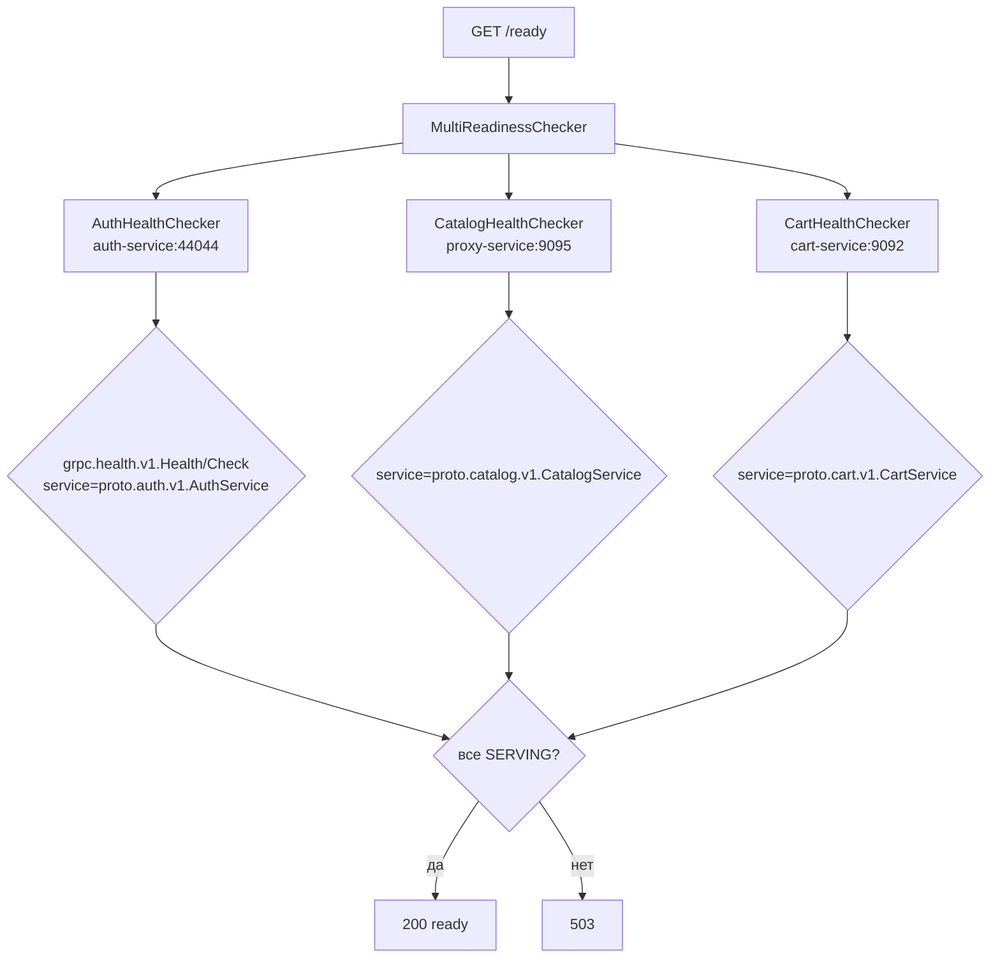

# internal/transport/grpc/v1/handlers

Readiness-проверки внутренних зависимостей. Несмотря на путь `transport/grpc`, gRPC-сервера gateway не поднимает — пакет содержит только gRPC-**клиентов** для health-проверок.

```text
handlers/
├── auth_health_check.go     # AuthHealthChecker
├── catalog_health_check.go  # CatalogHealthChecker
├── cart_health_check.go     # CartHealthChecker
└── multi_readiness.go       # MultiReadinessChecker
```

## Как это работает



Каждый чекер реализует один метод:

```go
func (c CatalogHealthChecker) Check(ctx context.Context) error
```

`MultiReadinessChecker` держит слайс таких интерфейсов и возвращает ошибку, если хоть один не прошёл. Добавление зависимости — это добавление элемента в слайс в [`internal/app`](../../../../app), без изменений в роутере.

## Стандартный health-протокол

Используется `grpc.health.v1.Health` — не самописный эндпоинт. Запрос содержит имя конкретного сервиса:

```go
client.Check(ctx, &healthpb.HealthCheckRequest{
    Service: "proto.catalog.v1.CatalogService",
})
```

Разница между пустым именем и конкретным существенна: пустое означает «процесс жив», конкретное — «именно этот сервис готов обслуживать». Внутренние сервисы регистрируют оба статуса и переводят их в `NOT_SERVING` при начале graceful shutdown, что даёт gateway возможность увести трафик до фактической остановки.

## Проверка каталога идёт через прокси

`CatalogHealthChecker.Addr` в docker-конфиге — `proxy-service:9095`, а не `catalog-service:9091`. Так проверяется весь путь целиком: если прокси упал, каталог недостижим для gateway, и readiness обязан это отразить. Прокси прозрачен на уровне TCP, поэтому health-запрос доходит до каталога без изменений.

## TLS

Чекеры используют те же клиентские сертификаты, что и рабочие клиенты — `buildAuthTransportCredentials(c.TLS)`. Без валидного сертификата health-проверка не пройдёт, то есть `/ready` заодно проверяет и корректность mTLS-конфигурации.

## Известные проблемы

* **Новое соединение на каждую проверку.** `grpc.DialContext(..., WithBlock())` + `defer conn.Close()` в каждом чекере. Docker healthcheck опрашивает `/ready` раз в 10 секунд → три TCP-подключения с полным TLS-рукопожатием каждые 10 секунд, плюс столько же на каждый внешний запрос `/ready`. Хуже того, `/ready` может вернуть `503` из-за неудачи установки соединения при полностью рабочем клиенте, который уже держит соединение с тем же сервисом. Правильно — передавать чекерам существующие `*grpc.ClientConn` из `App` и вызывать `Health/Check` на них.
* **Проверки выполняются последовательно.** Три чекера опрашиваются друг за другом, поэтому худшее время ответа `/ready` — сумма трёх таймаутов (до 30 секунд при `timeout: 10s`). Это больше, чем `timeout: 5s` у самого healthcheck в compose, то есть проверка успеет отвалиться по своему таймауту. Нужен `errgroup` с параллельным опросом.
* **Четвёртая копия сборки TLS-credentials.** `buildAuthTransportCredentials` дублирует то же, что делают три клиента в [`client/grpc`](../../../../client/grpc).
* **Имена сервисов зашиты строками** в каждом чекере, хотя внутренние сервисы экспортируют их как константы (например `authgrpc.ServiceName`).
* **Путь пакета вводит в заблуждение** — `transport/grpc/v1/handlers` предполагает серверные хендлеры, а лежат клиентские проверки. Уместнее было бы `internal/health`.
