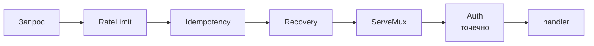
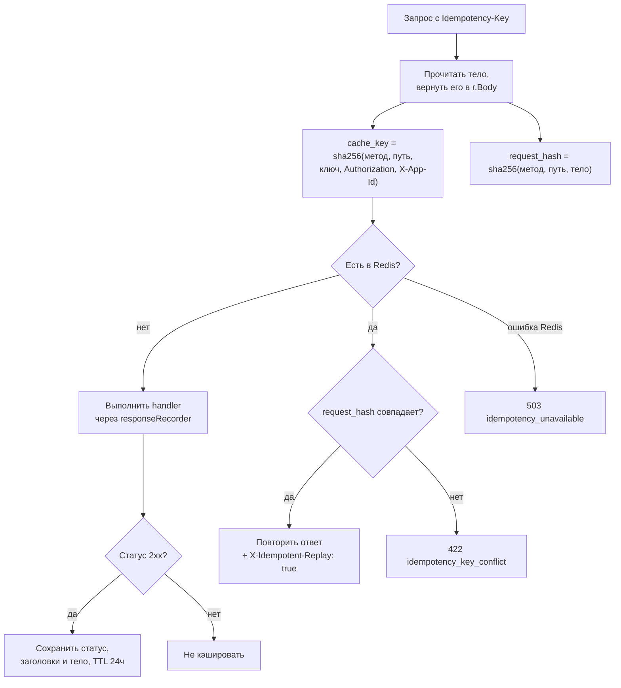
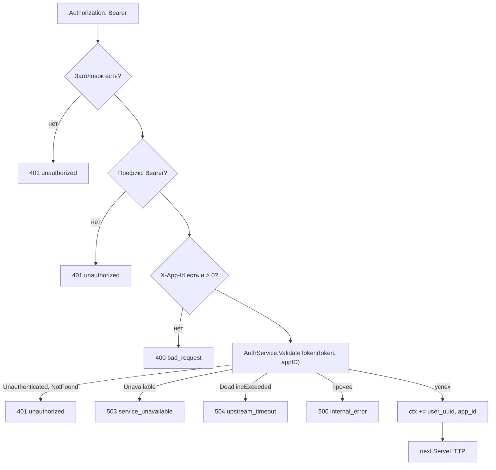

# internal/transport/http/v1/middleware

Cross-cutting логика HTTP-слоя: ограничение частоты, идемпотентность, авторизация, перехват паник.

```text
middleware/
├── chain.go        # композиция
├── ratelimit.go    # sliding window по IP
├── idempotency.go  # кэш ответов по Idempotency-Key
├── auth.go         # Bearer + X-App-Id → ValidateToken
├── admin.go        # RequireAdmin: после Auth, IsAdmin → 403
├── recovery.go     # recover() → 500 JSON
└── response.go     # writeError / writeJSON
```

## Композиция

```go
func Chain(h http.Handler, middlewares ...Middleware) http.Handler {
    for i := len(middlewares) - 1; i >= 0; i-- {
        h = middlewares[i](h)
    }
    return h
}
```

Обход с конца означает, что первый аргумент окажется **внешним** слоем. В [`router.go`](../router.go):

```go
middleware.Chain(mux,
    middleware.RateLimit(...),    // внешний — выполняется первым
    middleware.Idempotency(...),
    middleware.Recovery(...))     // внутренний — ближайший к mux
```

`Auth` в цепочку не входит: он навешивается точечно на защищённые маршруты, потому что `/auth/login` и `/auth/register` должны быть доступны без токена.

## Порядок и почему он такой



**RateLimit раньше Auth** — иначе перебор токенов не стоил бы атакующему ничего: каждая попытка валидации уходила бы в `shop-auth`.

**Idempotency раньше handler** — повторный запрос не должен доходить до внутренних сервисов вообще.

**Recovery внутри** — перехватывает паники хендлеров. Обратная сторона: паника в самих `RateLimit` или `Idempotency` под него не попадёт.

## RateLimit

Ключ — IP-адрес из `r.RemoteAddr`, разобранный через `net.SplitHostPort`. Алгоритм — sliding window в Redis, см. [`internal/ratelimit`](../../../../ratelimit).

Поведение при отказах:

| Ситуация | Реакция |
|---|---|
| Лимитер не сконфигурирован (`nil`) | Пропустить, `Debug`-лог |
| Пустой или неразбираемый `RemoteAddr` | Пропустить, `Warn`-лог |
| Redis недоступен | Пропустить (fail-open), `Error`-лог |
| Лимит исчерпан | `429 rate_limit_exceeded` + `Retry-After` — через сколько секунд освободится место |

Fail-open выбран сознательно: лимитер — вспомогательная защита, и падение Redis не должно класть весь публичный API. Для идемпотентности наоборот — fail-closed (`503`), там пропуск означал бы двойное списание.

## Idempotency

Применяется только к `POST`, `PUT`, `PATCH`, `DELETE` и только при наличии заголовка `Idempotency-Key`. Без ключа запрос проходит как обычно — механизм opt-in.



Две детали делают механизм корректным.

**Тело читается и возвращается обратно.** `io.ReadAll(r.Body)` исчерпывает поток, поэтому создаётся новый: `r.Body = io.NopCloser(bytes.NewReader(body))`. Без этого хендлер получил бы пустое тело.

**Хэш тела отделён от ключа кэша.** Ключ определяет, куда смотреть; `request_hash` — проверка, что клиент не переиспользовал тот же ключ для другого запроса. Это ровно та ситуация, которую спецификация идемпотентности предписывает отклонять, а не молча отдавать старый ответ.

`Authorization` входит в ключ кэша: одинаковые ключи от разных пользователей не пересекутся.

Кэшируются только успешные ответы (2xx) — повторять `500` бессмысленно, клиент должен иметь возможность повторить попытку.

## Auth



401 — только когда auth **ответил**, что токен плохой или пользователь деактивирован. Для фронта 401 значит «сессия кончилась, стереть токены»; если бы так же отвечать на недоступность auth, его рестарт разлогинил бы всех разом и вызвал шторм логинов на bcrypt.

Идентичность пользователя кладётся в контекст типизированными ключами:

```go
type contextKey string
const userUUIDKey contextKey = "user_uuid"
```

Собственный тип ключа вместо `string` исключает коллизии с другими пакетами, которые могли бы положить в контекст значение под тем же именем.

Хендлеры читают через `UserUUIDFromContext(ctx)` и `AppIDFromContext(ctx)`. Есть также `ContextWithUserUUID` — для тестов хендлеров без прохождения middleware.

Важное следствие: `user_id` во всех операциях с корзиной берётся **из токена**, а не из тела запроса. Обратиться к чужой корзине невозможно.

## RequireAdmin

Ставится **после** `Auth` и закрывает `/admin/log-level`: токен к этому моменту проверен, `user_uuid` лежит в контексте, остаётся вызвать `IsAdmin`. Не администратор — `403`; ошибки вызова auth разбираются тем же `writeUpstreamError`, что и в `Auth` (`401` только на отказ по токену, недоступность — `503`/`504`). Если перед ним забыли поставить `Auth`, контекст пуст и ответ — `500`: эндпоинт закрывается, а не открывается.

## Recovery

`recover()` → лог с полями метода и пути → `500` с телом `{"error":{"code":"internal","message":"internal server error"}}`. Паника одного запроса не роняет процесс.

## Известные проблемы

* **RateLimit по `r.RemoteAddr`.** За балансировщиком это адрес балансировщика — лимит станет общим для всех клиентов. `X-Forwarded-For` не учитывается (и, если учитывать, требует доверенного списка прокси, иначе заголовок подделывается).
* **`Idempotency` буферизует ответ целиком в памяти.** Для текущих JSON-ответов это неважно, но `responseRecorder` применяется ко всем write-методам без ограничения размера.
* **Ответ без явного `WriteHeader` не кэшируется.** Если хендлер ничего не записал, `recorder.statusCode` остаётся `0` и проверка `>= 200` не проходит. Пустой `204` не попадёт в кэш.
* **Кэширование `/auth/login`.** Формально корректно, но повтор с тем же `Idempotency-Key` в течение 24 часов вернёт **ту же пару токенов** вместо выпуска новой. Стоит либо исключить auth-маршруты, либо сократить для них TTL.
* **TTL зашит в роутере** (`24*time.Hour` литералом в `router.go`), а не берётся из конфига.
